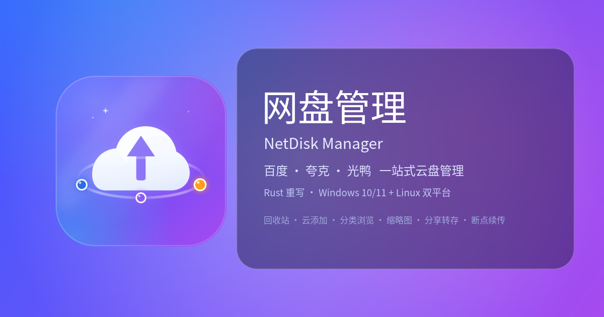
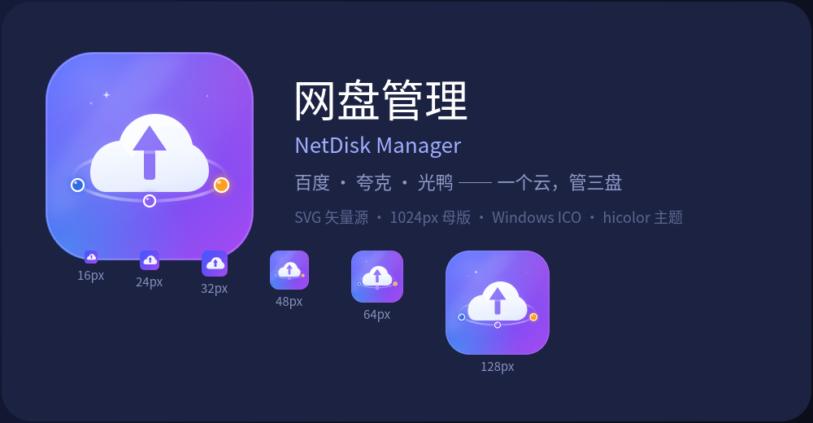

# 网盘管理 · Rust 重写版（V10）



> 只读学习工作区里的四个 Python 项目
> （[百度网盘适配器](../百度网盘适配器) / [夸克网盘适配器](../夸克网盘适配器) / [光鸭云盘适配器](../光鸭云盘适配器) / [网盘管理_V2](../网盘管理_V2)）
> 之后，**用 Rust 从最底层协议重写**的图形界面网盘管理工具。
>
> * **纯 Rust GUI**（eframe / egui），单可执行文件；
> * **Windows 10/11 + Linux 同一套代码**，无 Qt/PySide/WebView 等系统 GUI 依赖；
> * 三家网盘**进程内原生适配器**，无 Python、无子进程桥、不依赖 Alist/rclone；
> * 无网盘账号也能用内置「演示网盘 / 本机」跑通全部界面（含截图验收）。

---

## 1. 功能

| 能力 | 状态 | 说明 |
|---|---|---|
| 百度 / 夸克 / 光鸭 登录 | ✅ | 扫码（百度服务端下发二维码、夸克本地生成）/ Cookie / 短信（光鸭）/ 令牌（光鸭） |
| 文件浏览 | ✅ | 目录导航（前进/后退/上级/面包屑）、排序、本地筛选、批量选择、右键菜单 |
| 文件管理 | ✅ | 新建文件夹、重命名、删除、移动、复制、搜索 |
| 上传 | ✅ | 按各家协议分片/秒传/并发；上传前敏感词守卫 |
| 下载 | ✅ | 直链 + 断点续传 + 大文件多段并发 |
| 传输队列 | ✅ | 小/大文件分级并发、失败重试（指数退避）、暂停/继续/取消、任务持久化（重启恢复） |
| 跨盘传输 | ✅ | 源盘下载到本地缓存 → 目标盘上传（不经第三方中转） |
| 敏感词守卫 | ✅ | AC 自动机、最长命中、按实例词库、警告/拦截/自动改名（拼音规避）、百度非法字符命名规避 |
| 分享 | ✅ | 创建/列表/取消；**分享链接校验 + 转存**（百度/夸克） |
| 回收站 | ✅ 新增 | 列表 / 恢复 / 彻底删除 / 清空（按各家实际接口能力显示） |
| 云添加（离线下载/BT） | ✅ 新增 | 光鸭云盘：直链/magnet 创建任务 + 任务列表；百度因创建参数未抓到暂不实现 |
| 上传记录 / 操作记录 | ✅ 新增 | 光鸭云盘 |
| 分类浏览 | ✅ 新增 | 百度网盘：全盘视频/音频/图片/文档/应用/其它 |
| 缩略图预览 | ✅ 新增 | 列表内 18px 小图 + 详情弹窗大图；百度/夸克/光鸭（含 WebP 解码），懒加载+缓存 |
| 百度云添加（离线下载） | 🟡 参数已通真机校验 | 创建参数经真机验证通过（当前账号超容被 36009 拒绝）；错误码 36005~36032 全部中文映射 |
| 多账号实例 | ✅ | 同一家网盘可挂多个账号，凭证目录互相隔离 |
| 文件夹（目录）传输 | ✅ | 上传/下载/跨盘复制**递归**保持多重嵌套结构与空目录；整目录进度按总字节计算（真机验证：光鸭/夸克/本机；百度只读会话下仅读目录） |
| 主题 | ✅ | 10 套（Dracula / One Dark / Nord / Tokyo Night / Catppuccin …），对齐 V2 主题管理器 |
| 播放内核 / AI / 刮削 / 弹幕 | ❌ 不移植 | V2 的视频播放与 AI 是另一套大工程，不属于「网盘管理」核心（详见 [PORTING.md](docs/PORTING.md)） |

**键盘**：`Ctrl+1…6` 切页 · `F5` 刷新 · `Backspace` 后退 · `Enter` 打开 · `Delete` 删除 · `Esc` 关对话框。

---

## 2. 快速开始

### 2.1 直接运行（已构建好的二进制）

```bash
# Linux 绿色版目录（解压即用）
./网盘管理 --demo          # 演示模式：无需账号，直接看界面/跑传输
./网盘管理                 # 正常模式
./网盘管理 --drive local   # 以「本机」网盘启动（把主目录当网盘浏览）
```

Windows：双击 `网盘管理.exe`（无控制台窗口；日志在数据目录的 `日志/` 下）。

### 2.2 安装到桌面（Linux）

图标、desktop 文件与安装脚本都在 `assets/icons/`，一条命令完成桌面集成：

```bash
# 绿色版自带的安装脚本（装到当前用户，无需 sudo）
./出/网盘管理-linux-x64/安装桌面图标.sh

# 或者：系统级安装 / 指定二进制 / 卸载
sudo ./scripts/install-desktop.sh --prefix /usr/local
./scripts/install-desktop.sh 出/网盘管理-linux-x64/网盘管理
./scripts/install-desktop.sh --uninstall
```

装好后应用菜单搜索「**网盘管理**」即可启动（图标走 hicolor 主题，窗口类名 `wangpan-v10`）。
手工安装也可以：把 `assets/icons/netdisk-manager.svg` 复制到
`~/.local/share/icons/hicolor/scalable/apps/`，把 `assets/netdisk-manager.desktop`
复制到 `~/.local/share/applications/`（`Exec` 改成你的二进制绝对路径）。

### 2.3 从源码构建

**Linux**

```bash
# 依赖：rustup（stable）、系统 OpenGL/X11 运行库
./scripts/build-linux.sh              # release 构建
./scripts/build-linux.sh --portable   # 顺带生成绿色版目录 出/网盘管理-linux-x64/
```

**Windows 10/11**

```powershell
# 依赖：rustup（MSVC 工具链）+ Visual Studio Build Tools（C++ 桌面开发）
powershell -ExecutionPolicy Bypass -File .\scripts\build-windows.ps1
powershell -ExecutionPolicy Bypass -File .\scripts\build-windows.ps1 -Portable
```

> 两个构建脚本都用 `cargo metadata` 解析真实产物路径，
> 兼容 `CARGO_TARGET_DIR` 被环境变量重定向的机器（本机就是这种情况）。

### 2.4 无头冒烟验收（CI 同款）

```bash
./scripts/build-linux.sh
./scripts/smoke-headless.sh    # Xvfb 里跑页面+对话框+工具页+缩略图共 23 项并截图 → 出/验收截图/*.png
```

单页/单对话框截图（排查 UI 用）：

```bash
网盘管理 --drive demo --path "/影视/科幻" --screenshot /tmp/x.png --frames 24
网盘管理 --drive demo --dialog login     --screenshot /tmp/x.png   # 对话框：login/newfolder/rename/
                                                                  # delete/move/share/crosscopy/details/filepicker
```

### 2.5 命令行入口 `wp-cli`（真机联调 / 脚本化）

GUI 之外还有同一套适配器的 CLI，适合批量验证、自动化和无显示环境（所有结果输出 JSON）：

```bash
./出/网盘管理-linux-x64/wp-cli --drive guangya login-qr --qr-out /tmp/qr.png  # 二维码存 PNG
./出/网盘管理-linux-x64/wp-cli --drive guangya ls /
./出/网盘管理-linux-x64/wp-cli --drive quark upload /tmp/a.bin /测试目录
./出/网盘管理-linux-x64/wp-cli --drive quark download /测试目录/a.bin /tmp/a.bin
./出/网盘管理-linux-x64/wp-cli --drive baidu account   # 账号/容量
# 新增能力：
./出/网盘管理-linux-x64/wp-cli --drive quark recycle-list          # 回收站
./出/网盘管理-linux-x64/wp-cli --drive guangya cloud-add <链接|magnet> /目录
./出/网盘管理-linux-x64/wp-cli --drive guangya records             # 上传记录
./出/网盘管理-linux-x64/wp-cli --drive baidu categories video      # 分类浏览
./出/网盘管理-linux-x64/wp-cli --drive quark thumb /照片.jpg out.webp   # 下载缩略图
./出/网盘管理-linux-x64/wp-cli --drive quark share-info <分享链接> [提取码]
./出/网盘管理-linux-x64/wp-cli --help
```

（`--data-dir <目录>` 与 GUI 共用数据目录。）

### 2.6 自动化验收结果（本机实测）

| 项 | 结果 |
|---|---|
| `cargo check --workspace` | ✅ 0 error / 0 warning |
| `cargo test --workspace` | ✅ **216** 个测试全部通过 |
| `cargo build --release -p wp-gui` | ✅ 单文件约 24 MB |
| `scripts/smoke-headless.sh` | ✅ 23 项截图全部通过（页面 + 10 类对话框 + 5 个工具页 + 缩略图列表） |
| **接口覆盖** | [docs/API_COVERAGE.md](docs/API_COVERAGE.md)：百度 95 个 HAR 路径 + 夸克 24 接口 + 光鸭 30+ 接口的地毯式扫描矩阵（已实现/未实现原因） |
| **真机联调**（真实账号） | ✅ 光鸭/夸克全链路（登录/列目录/上传分片/下载 **sha256 一致**/直链/分享/删除）；百度：Cookie 登录后列目录/建目录/重命名/删除/下载/分享 ✅，文件上传因**账号超容**被服务端拒绝（errno:-10，非客户端问题）——详见 [待验证清单](docs/待验证清单.md) |

详细报告：[docs/验收报告.md](docs/验收报告.md)

---

## 3. 使用

### 3.1 添加/登录网盘（含同一网盘多账号）

1. **添加网盘 / 本机**（任何状态下都可点）：顶栏 **「＋ 添加」**、网盘页空状态按钮、
   或「设置 → 网盘账号 →『＋ 添加网盘 / 本机』」都会打开**选择弹窗**：
   百度网盘 / 夸克网盘 / 光鸭云盘 / 本机 / 演示网盘，并显示每类**已有实例数**；
   * 云盘可选后创建实例（同一家可加多个账号，标识 `baidu_2`、`quark_2`…，凭证在
     `数据/账号/<标识>/` 彼此隔离，可同时登录、随时在顶栏切换）；
   * 本机 / 演示网盘为单实例：已有则按钮变 **「切换」**，不会重复创建；
   * **即使把某类网盘（甚至全部）实例都删除，也能在这里重新添加**，不会卡死；
2. 右键任意顶栏网盘标签也可快捷操作：「登录/更换账号、退出登录、刷新、
   再加一个 XX 账号、移除实例」；
3. 登录方式（扫码 / Cookie / 短信 / 令牌）：扫码等二维码出现 → 手机 App 扫码确认；
   Cookie 从浏览器复制（百度也接受 `BDUSS=…; STOKEN=…`）；
4. 顶栏网盘标签：悬停显示「实例 / 账号 / 登录状态」；右键菜单可 **登录/更换账号、退出登录、
   刷新、再加一个同类型账号、移除实例**；状态点绿=已登录、黄=未登录、红=异常。

### 3.2 上传 / 下载 / 传输

* 上传：网盘页 →「⬆ 上传」→ 多选文件；或「⬆ 上传文件夹」→ 选择本地目录（**递归上传**）；
* 下载：勾选文件/目录 →「⬇ 下载」（**目录递归下载**，保持多重嵌套结构；已存在且大小一致的文件自动跳过）；
* 跨盘：勾选条目 →「⋯ 更多 → 跨网盘传输」→ 选目标网盘/目录（**目录也支持递归复制**）；
* 传输页支持全部暂停/继续/取消、失败重试、清除已完成、打开下载目录；
* 目录传输进度按整棵目录的字节总和计算，任务备注显示「N 个文件 / M 个子目录」；
* 任务行显示「源实例 → 目标实例」，多账号时不会看错是哪个账号在传；
* **空目录传输**：源目录没有文件时会显示「100%（空目录）」并在目标端建出目录树（不是 0% 卡住，
  也不会静默丢内容）；目录上传/跨盘重试是幂等的（同名同大小文件跳过，不会生成 `a(1).txt` 副本）。

### 3.4 常见故障：百度「会话只读 / errno:-6」

现象：百度实例显示已登录、能浏览/下载，但**上传、新建文件夹、改名、删除、分享**都失败，
提示「会话只读或已失效（errno:-6）」。

原因：百度的写操作需要 **CSRF 令牌（bdstoken）**，而它由 `gettemplatevariable` 用最新
Cookie 换取；如果浏览器里重新登录过（STOKEN 被轮换）、或 Cookie 里没有最新 `STOKEN`，
就会出现「读接口正常、写接口恒 -6」的只读会话。这是百度服务端判定，不是客户端 bug。

处理（任选其一）：
1. 点该实例「登录」→ **重新扫码**（会拿到最新 STOKEN）；
2. 或浏览器重新登录 [pan.baidu.com](https://pan.baidu.com/) → F12 复制最新
   `BDUSS=…; STOKEN=…`（建议连同 `BDUSS_BFESS`）→「登录 → Cookie」导入；
3. 若账号空间已超限（容量页 free=0），先清理/扩容。

GUI 会把这种状态标成 **「已登录（只读）」**（橙点/橙色状态），鼠标悬停/账号页可见提示；
打开程序时也会弹一次提醒。

另：删除实例只移除配置，**凭证目录会保留**（重新添加同标识实例可复用旧会话；要彻底清除请删
`数据/账号/<实例标识>/`）。删除某类全部实例后，用顶栏「＋ 添加」仍可重新创建。

### 3.3 敏感词守卫

「设置 → 敏感词守卫」开启并选策略（警告/拦截/自动改名），
在「敏感词」页维护**全局词**和**按网盘实例的词**。命中「自动改名」时用拼音替换命中词，
并按目标网盘字符集规则规避非法字符（百度：`\ / : * ? " < > |` → 全角等价、emoji 移除）。

---

## 4. 数据目录

**绿色模式**（可执行文件旁有 `portable` 文件或已存在 `数据/` 目录）：
所有数据在 `可执行文件/数据/`，适合 U 盘/解压即用。

**用户模式**（默认）：

| 平台 | 数据目录 |
|---|---|
| Windows | `%APPDATA%\网盘管理V10\` |
| Linux | `~/.local/share/网盘管理V10/` |

```
数据/
├─ 配置.json          # 网盘实例/传输/下载/界面/敏感词配置（可手工编辑）
├─ 任务.json          # 传输任务库（重启恢复）
├─ 敏感词.json        # 词库 + 命中改名记录
├─ 账号/<实例标识>/   # 每个网盘实例的凭证（独立隔离）
├─ 下载/              # 默认下载目录
├─ 缓存/              # 跨盘传输中转文件
└─ 日志/运行-*.log    # 运行日志（崩溃另见 崩溃.log）
```

可用环境变量 `WP_DATA_DIR=<目录>` 强制指定数据目录（开发/验收用）。

> 网盘凭证等价于账号密码：数据目录请勿提交版本库（`.gitignore` 已排除 `数据/`）。

---

## 5. 架构

```
crates/
├─ wp-core       数据模型 / 配置 / 路径 / 日志 / 敏感词守卫 / 工具
├─ wp-net        HTTP 客户端 / Cookie / 摘要与签名 / 下载器 / 重试
├─ wp-drive      统一 Drive trait + 本机驱动 + 演示网盘
├─ wp-drive-baidu / wp-drive-quark / wp-drive-guangya   三家网盘协议实现
├─ wp-transfer   传输引擎（队列/并发/重试/暂停/持久化/跨盘）
└─ wp-gui        eframe/egui 图形界面（主程序）
```

* **进程内适配器**：V2 因为三家 Python 适配器的顶层包同名（`核心/`、`界面/`）而被迫用
  「每适配器一个子进程 + 行式 JSON 桥」；Rust 没有这个限制，直接 `Arc<dyn Drive>` 进程内调用，
  删掉整个桥层与 Python 运行时依赖。
* **全异步**：所有网络/传输在 tokio 上跑，GUI 线程只做渲染与事件循环；
  传输引擎在后台线程池调度，进度经共享快照渲染，界面不卡顿。
* **强类型**：`RemoteEntry / TransferTask / AccountInfo / DirectLink…` 全部 serde 强类型，
  取代 V2 的 dict + 中文键桥协议。

详见 [docs/ARCHITECTURE.md](docs/ARCHITECTURE.md) 与 [docs/PORTING.md](docs/PORTING.md)。

---

## 6. 已知限制与待验证

* **本机没有三家网盘的真实账号**：协议实现是逐行移植 Python 源码 + 纯函数单元测试
  （签名/状态码/响应解析/分片切分），但**登录、秒传、真实上传下载仍需真机回归**。
  验收步骤见 [docs/待验证清单.md](docs/待验证清单.md)。请把失败日志（`数据/日志/`）反馈。
* 分享/回收站：分享已实现协议；回收站与「云添加」为 P2（界面未暴露）。
* 上传断点续传：暂不支持（需要后端分片会话协议）；目录内单文件下载支持大小一致跳过/断点续传。
* Windows 上的构建/运行由 CI 验证编译与打包；GUI 截图验收在 Linux（Xvfb）完成。

---

## 7. 国内网络 / Cargo 镜像说明

仓库自带 `.cargo/config.toml`（crates.io → 中科大镜像）。这是为本机构建环境准备的
（本机 `CARGO_HOME` 被重定向，全局镜像配置会失效）。**换到别的机器/网络时**：

* 能直连 crates.io：删除 `.cargo/config.toml` 即可；
* 用其它镜像：把文件里的 `registry` 换掉。

## 8. 图标与品牌



| 文件 | 说明 |
|---|---|
| `assets/icons/netdisk-manager.svg` | 主图标矢量源（≥48px 使用） |
| `assets/icons/netdisk-manager-small.svg` | 小尺寸专用版（16~32px 去掉星环与星屑，保证可辨识） |
| `assets/icons/netdisk-manager-{16,24,32,48,64,128,256,512,1024}.png` | 多尺寸 PNG（hicolor 主题 / 打包用） |
| `assets/icons/netdisk-manager.ico` | Windows 可执行文件图标（多尺寸 ICO） |
| `assets/netdisk-manager.desktop` | Desktop Entry 模板（安装脚本会替换 Exec 路径） |
| `assets/icons/hero.png` / `preview.png` | 品牌横幅 / 多尺寸预览（文档用） |

图标设计：深空极光底（蓝→紫）+ 白色云朵（内含负空间上传箭头）+ 行星环上三颗「网盘星」
（百度蓝 / 夸克紫 / 光鸭橙）——**一个云，管三盘**。

## 9. 目录

```
网盘管理_V10/
├─ Cargo.toml / Cargo.lock      # workspace
├─ crates/                      # 8 个 crate（见上）
├─ docs/
│  ├─ research/                 # 重写前对四个 Python 项目的只读研究规格（协议事实源）
│  ├─ ARCHITECTURE.md
│  ├─ PORTING.md                # Python → Rust 移植对照表
│  └─ 待验证清单.md
├─ scripts/                     # 构建 / 无头冒烟脚本
└─ .github/workflows/build.yml  # Linux + Windows CI
```

> 本项目是**独立重写**：源项目只读参考，未修改任何源文件；研究规格文档保留了
> `文件:行号` 引用，便于回溯核对。

## 10. 播放器规划（设计阶段，未实现）

计划新增「播放器页」：播放**网盘视频**、**本地视频**与 **4K/ISO 蓝光原盘**，要求**完整字幕**、
**4K 流畅**、后期接入 **AI** 与 **弹幕**，并保证**源码可控**。

- **架构设计（当前方案）**：[docs/PLAYER_ARCHITECTURE.md](docs/PLAYER_ARCHITECTURE.md)
  （libmpv 媒体内核 LGPL 构建 + 双渲染模式 + 完整字幕 + 流缓存 + AI 子系统 + 弹幕子系统 + 源码可控构建）
- **任务计划**：[docs/PLAYER_TASKS.md](docs/PLAYER_TASKS.md)
  （M0 技术验证 → M1 播放内核 → M2 完整字幕 → M3 源接入/ISO → M4 AI 基建+翻译 → M5 弹幕 → M6 打包验收 → M7 进阶；
  约 50–72 人日，待确认后开工）

### 进度（2026-10-19）

| 里程碑 | 状态 | 证据 |
|---|---|---|
| **M0 技术验证** | ✅ 完成 | [PLAYER_M0_RESULTS.md](docs/PLAYER_M0_RESULTS.md)：LGPL libmpv 一键构建（3.3MB/3min）、Mode A render API 出帧+UI 同帧合成、ASS 弹幕副字幕轨、VAAPI copy-back（4K HEVC CPU 0.76→0.27 核）、HLS 真机播放+seek |
| **M1 播放内核** | ✅ 完成（Linux） | GUI 真实 libmpv 播放：`25-真实播放.png`（真实帧满铺，bbox 偏差 ≤1px，00:17/00:20）；`cargo test --workspace` **543 passed / 0 failed**；headless 冒烟 **25/25**（含真实播放 case）；真机桌面零拷贝/4K60/Windows ANGLE 待下一轮 |
| **M3 真机矩阵** | ✅ 三盘验证 | [PLAYER_REAL_DEVICE_MATRIX.md](docs/PLAYER_REAL_DEVICE_MATRIX.md)：百度/夸克/光鸭 6 用例（含夸克 HLS 173MB、光鸭 727MB）mpv 可播+seek；脚本可复跑 |
| **流自适应/健壮性** | ✅ 完成 | 首字节 55.8s→0.84s（66×）、mpv 端到端起播 26s→12.2s（2.1×）、seek 优先预读、弱网自适应（预读 128→32MB）、**上游 4xx 连续失败熔断**（百度 31326：41 次换链→≤2，3s 内可读 502）；见 [PLAYER_PERF.md](docs/PLAYER_PERF.md) |
| **M6 合规运行时** | ✅ 完成（Linux） | 自建 **LGPL FFmpeg 8.0** + 重链 LGPL libmpv（libavcodec.so.62，sha256 4994092c…）→ 自包含 `播放器运行时/`（126MB/108 依赖 .so，patchelf rpath）**合规校验 PASS**（无 x264/x265/rubberband、7 个 FFmpeg 库全部自建 LGPL、LD_DEBUG 系统 libavcodec 加载 0 次）；干净 env dlopen + 1080p 播放首帧 38–115ms；发布验收 22 项 PASS（[PLAYER_PACKAGING.md](docs/PLAYER_PACKAGING.md)） |
| **M2 字幕真机** | ✅ 完成 | [PLAYER_SUBTITLE_M0.md](docs/PLAYER_SUBTITLE_M0.md)：外挂 SRT/VTT/ASS、ASS 样式+定位、主+副字幕同屏、内嵌 SRT mkv、**AI 双语注入端到端**（像素级差分证据 15+4 用例）；接口补齐（副字幕命令/字体目录/自动加载）+ [PLAYER_E5_RESULTS.md](docs/PLAYER_E5_RESULTS.md) 真机复测（sub-reload/AI 重译生效、发行运行时下验证） |
| **M7 AI P3** | ✅ 原型 | [PLAYER_AI.md](docs/PLAYER_AI.md) §5：字幕摘要/章节生成（窗口分批/JSON 容错/缓存/降级），`cargo run -p wp-ai --example summarize_srt` 无 key 可跑；81 测试 all-features |
| **M6 Windows 准备** | ✅ 资产就绪 | `.github/workflows/player-windows.yml`（MSYS2 LGPL FFmpeg+mpv 构建+打包+验证）、`scripts/fetch-angle.ps1`（ANGLE 固定来源+sha256 pin）、`scripts/windows-verify.ps1`（W1–W7）；[PLAYER_WINDOWS_ANGLE.md](docs/PLAYER_WINDOWS_ANGLE.md) 用户机器验证步骤 |
| **M3 GUI 网盘播放** | ✅ 打通 | `26-网盘播放-光鸭mkv.png`（代理流 694MB，seek 120s）、`27-网盘播放-夸克HLS.png`（HLS 直连，seek 60s）、`28-网盘播放-百度不可播提示.png`（31326 可读提示不崩）；`--play-remote/--seek-ms` 验收参数；真网盘用例在 smoke 中默认跳过（`WP_SMOKE_REAL_NET=1` 开启） |
| 流代理 | ✅ 完成 | [PLAYER_STREAM_M0.md](docs/PLAYER_STREAM_M0.md)：三盘 Range 206、磁盘预读缓存/过期换链、夸克 HLS 决策；性能数据见 [PLAYER_PERF.md](docs/PLAYER_PERF.md)（起播=chunk/带宽、缓存命中 seek 0.2–9.5ms、多连接聚合 4–5×） |
| 夸克大文件 | ✅ 完成 | [PLAYER_QUARK_STREAM.md](docs/PLAYER_QUARK_STREAM.md)：23018 突破 → 云端转码 HLS 真机可播可 seek |
| 字幕/弹幕内核 | ✅ 完成 | 字幕 59+5、弹幕 80+6 测试；格式矩阵与集成素材在 `出/验收截图/字幕弹幕/` |
| AI 子系统 | ✅ 基础完成 | [PLAYER_AI.md](docs/PLAYER_AI.md)：远端/本地 LLM、本地 whisper ASR、翻译→双语 ASS 闭环（wp-ai 67 测试 all-features） |
| 蓝光主标题 | ⏳ 下一轮 | 需未加密 ISO/BDMV 样本做 E6 |
| Windows ANGLE | ⏳ 需 Windows 测试机 | 方案见 [PLAYER_WINDOWS_ANGLE.md](docs/PLAYER_WINDOWS_ANGLE.md) |
- **性能压测与调参**：[docs/PLAYER_PERF.md](docs/PLAYER_PERF.md)（起播公式/seek/弱网/HLS 实测 + 4K 参数建议）
- **第一轮调研记录**：[docs/PLAYER_RESEARCH.md](docs/PLAYER_RESEARCH.md)
  （只读研究 tealinux-iso / VLC；含 VLC 嵌入 API、许可证、Tea Linux 发行范式；附第二轮 mpv 补充事实）

> 阶段结论：媒体内核选 **libmpv（LGPL 动态链接，pin v0.41.0）**——完整字幕栈（libass + 位图字幕）、
> 硬解/HDR、libbluray 蓝光、AI 挂钩点与源码自建能力都是最优；渲染按平台双模式
> （Linux 进程内 GL render API；Windows 原生子窗口 + D3D11VA）；网盘流走本地磁盘预读缓存代理；
> 弹幕后续以「egui 覆盖层（Mode A）/ 预生成 ASS 弹幕轨（Mode B）」双通道接入。
